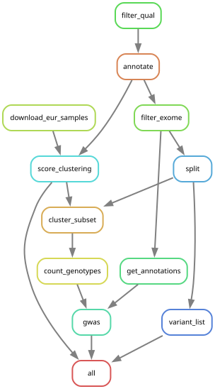

# Predicting Genetic Variants with Discordant Post-Imputation Allele Frequency

Supplementary code for the master's thesis of M. Filippov, ITMO University, 2023–2025.

Genotype imputation can produce variants whose allele frequencies differ from those observed in
sequencing data, which leads to false-positive associations. This project:

1. Runs QC on imputed 1000 Genomes genotypes, annotates them with Ensembl VEP and keeps protein-coding variants.
2. Clusters samples by ancestry and compares imputed and genotyped allele counts against
   ancestry-matched public exome controls from the [SCoRe](https://dnascore.net/) platform.
3. Flags variants with discordant allele frequencies (weighted linear regression, Fisher and χ² tests, BH-FDR).
4. Trains gradient-boosting classifiers (XGBoost, LightGBM, CatBoost, tuned with Optuna) to predict
   discordant variants from imputation quality, frequency, conservation and functional annotations,
   validated with leave-one-chromosome-out cross-validation.

## Repository structure

| File | Description |
|---|---|
| `Snakefile` | Pipeline for QC, VEP annotation, coding-variant filtering, typed/imputed split, per-cluster genotype counts. Calls `SCoRe.R` and `GWAS.R`. For details, see section "Snakemake pipeline".|
| `Dockerfile` | R environment (R 4.4.2, tidyverse, SVDFunctions) for `SCoRe.R` and `GWAS.R`; published as `ghcr.io/pseudocephalus/itmo-thesis-r:1.0` |
| `config.yaml` | input path, R² threshold, CSQ terms, cluster list. Parameters live in `config.yaml` and can be overridden on the command line: `snakemake -c 4 --config r2_threshold=0.8`|
| `scripts/SCoRe.R` | Ancestry PCA and clustering ([SVDFunctions](https://github.com/alexloboda/SVDFunctions)); writes the SCoRe input `1000G.yaml` |
| `scripts/GWAS.R` | Case–control association tests against SCoRe controls; writes `results_full_annotated.csv` |
| `scripts/count_genotypes.awk` | Per-variant genotype counts (unknown, hom-ref, het, hom-alt) for one cluster |
| `exploration.Rmd` | Plots: MAF/R² distributions, Manhattan plot, p-value relationships |
| `training.ipynb` | Model selection, tuning and leave-one-chromosome-out evaluation |

## Requirements

Tested with Snakemake 9.27.1, bcftools 1.19, Ensembl VEP v113 (offline cache), R 4.4 and Python 3.10.
With containers, the only requirements are Snakemake and Apptainer. Each rule runs in a pinned image (bcftools, Ensembl VEP, and the R image built from Dockerfile); see containers in config.yaml. VEP still needs its offline cache in ~/.vep.

- R packages: `SVDFunctions` (`devtools::install_github("alexloboda/SVDFunctions")`), `dplyr`, `stringr`,
  plus `ggplot2`, `ggman`, `flextable`, `officer` for `exploration.Rmd`
- Python packages: see `requirements.txt`

## How to run

Run all commands from the repository folder.

1. Put the imputed VCF (Minimac-style `R2` and `TYPED` INFO fields) in the folder as `1000G.imputed.vcf.gz`.
2. Run QC and clustering with snakemake (asking for specific outputs):
   ```bash
   snakemake --sdm apptainer -c 4 1000G.yaml vars_typed.txt vars_imputed.txt variant_annotations.csv
   ```
   This writes 1000G.yaml, vars_typed.txt, vars_imputed.txt and variant_annotations.csv.
3. On the SCoRe platform, submit `1000G.yaml` with `vars_typed.txt` (default QC filters).
   Unpack the results into `controls_counts/` and rename each `counts_X.tsv` to `counts_typed_X.tsv`.
4. Repeat step 3 with `vars_imputed.txt`, renaming the files to `counts_imputed_X.tsv`
   (same `controls_counts/` folder).
5. Compute per-cluster genotype counts and run the association analysis (the rest of the pipeline):
   ```bash
   snakemake --sdm apptainer -c 4
   ```
   The result is `results_full_annotated.csv`; explore it with `exploration.Rmd`.
6. Model training is in `training.ipynb`. No data is included in this repository. The notebook
   expects a `data.csv` with the columns listed in its first cell (the GWAS results joined with
   VEP plugin annotations: GERP, gnomAD, SIFT, LCR). Set `DATA_PATH` and `N_TRIALS` environment
   variables to override the input path and the number of Optuna trials.
   
## Snakemake pipeline



- The control counts in `controls_counts/` come from the SCoRe web platform (steps 3–4), so they don’t appear in the graph.
- The number of ancestry clusters is set in `config.yaml` (clusters) and has to match what `SCoRe.R` produces.
